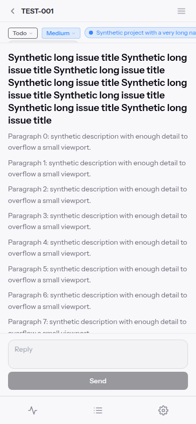
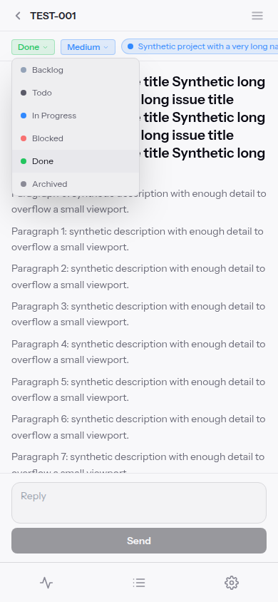

# Issue status and priority dropdowns

## Cause and choice

On upstream be4b87f the mobile metadata row sets overflow-x:auto, which computes overflow-y:auto too. Chromium measured a 41px clip. Archived had a normal bounding box at y242 but elementFromPoint at its center returned underlying content. Raising z-index cannot escape that ancestor clip.

Compact ChipSelect now uses a fixed body portal above the properties modal. Width and available height are bounded to visualViewport (window fallback); it opens below or above the trigger according to available space. Very short viewports scroll only the option panel. The horizontal metadata row, title, content scroll owner and desktop layout are unchanged. TypeaheadChipSelect in create-task forms is intentionally unchanged.

A local overflow/z-index adjustment is smaller but loses scrolling or retains clipping. A native select/sheet has less layout maintenance but changes interaction. A small anchored portal preserves the existing selectors across all three issue surfaces.

## Interaction

Outside pointer interaction dismisses without activating underlying content. Escape and selection restore trigger focus. Arrow keys, Home/End and Enter select through the focused trigger; Tab dismisses and moves naturally. Ancestor scroll and viewport resize/scroll dismiss instead of retaining stale anchoring. Scrolling inside the panel remains local. Effects/listeners and portal nodes are removed on close/unmount. Closed server rendering never accesses document.

## Reproduce and verify

Use the isolated harness in [issue-detail-scroll.md](issue-detail-scroll.md):

~~~sh
npm ci
npx playwright install --with-deps chromium
npm test
npm run typecheck
npm run build
npx playwright test
~~~

The shared synthetic fixture intercepts browser APIs (status POST, priority PATCH), replaces SSE and blocks service workers. No production task or credential is required. Dropdown specs use synthetic long titles, markdown, projects and tags at 320/390/613/767/768/1440 widths and short landscape heights. They hit-test option centers before actual selections and assert mocked mutation bodies, not merely bounding boxes. Existing issue-scroll specs remain required. Unit checks cover closed SSR, latest callbacks, portal placement and cleanup.

Chromium emulation is not physical iPhone/iOS proof. Deployment, real gateway acceptance and production task changes are outside this fix.

## Synthetic visual evidence

Both images below contain only generated TEST-001 content, not the reported private issue. Before: opening Todo leaves only a clipped menu edge. After: the same mobile metadata row can expose all six choices (shown after selecting Done). Automated hit-testing and actual mocked selections, rather than the images alone, establish reachability.

## Verified local results (2026-10-28)

Linux, Node 24, Playwright 1.61.1 with its pinned Chromium; mobile/touch contexts are emulation, not physical devices.

| Command | Result |
| --- | --- |
| Baseline build + original Archived center hit-test at be4b87f | Build passed; regression failed (expected true, received false) |
| npm test | 478 passed, 0 failed |
| npm run typecheck | Exit 0 |
| npm run build | Exit 0 |
| npm run test:browser | 41 Playwright tests passed (12 dropdown + 29 scroll), then 12 runtime browser checks passed |
| git diff --check | Exit 0 |

Dropdown coverage includes every status/priority with pointer input at eight viewport sizes and every option with touch emulation at 390px; first/final selections, modal status/priority, Home/End/arrows/Enter, Escape/Tab/outside dismissal, horizontal/vertical scrolling, resize across 767/768, orientation-sized resize, visualViewport dismissal, constrained local option scrolling, viewport bounds and no underlying navigation. Initial harness failures (status POST not modeled; missing shared makeComment export; properties accessible name) were corrected before the final complete run.

Existing Next instrumentation/standalone-start and Browserslist-age warnings remain; they are not introduced by this change. WebKit, physical iPhone and real macOS were not tested. No deploy, database migration, gateway change or production test mutation was performed.
